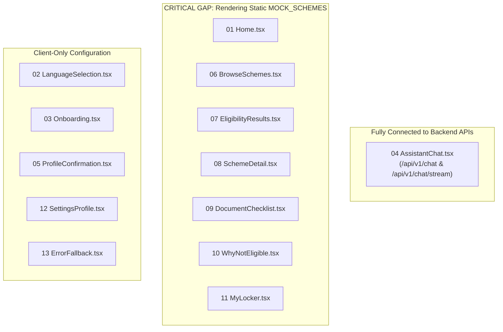
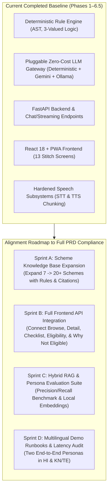

# Project Blueprint Alignment Audit: Yojana Saathi (योजना साथी)

**Document Type:** Formal Alignment Audit & Gap Analysis  
**Audited Against:** `PS5_Yojana_Saathi_PRD_TRD_System_Architecture_v2.md` (Authoritative Blueprint)  
**Supporting Reference Documents:** Problem Statement 05 Brief, `.stitch/DESIGN.md`, `.stitch/SITE.md`, Existing Phase 1–6 Technical Documentation & Codebase  
**Date of Audit:** November 11, 2026  
**Audit Status:** Completed — Pending Strategic Approval  

---

## Executive Summary

An exhaustive audit of the **Yojana Saathi** codebase was performed against the authoritative product blueprint (`PS5_Yojana_Saathi_PRD_TRD_System_Architecture_v2.md`). 

The current implementation has established a robust, privacy-compliant, zero-cost foundation:
1. A **deterministic rule engine** (`RuleEngineService`) executing declarative ASTs with three-valued logic (`TRUE`, `FALSE`, `UNKNOWN`), ensuring the LLM never decides eligibility.
2. A **pluggable zero-cost LLM gateway** with a guaranteed offline deterministic baseline, optional Ollama, and optional Gemini free tier.
3. A **RAG retrieval service** with SQLite FTS5 BM25 search, structured semantic chunking, and 100% official citation formatting.
4. An **ephemeral conversational orchestrator** with zero raw transcript persistence and strict allowlisting.
5. A **React 18 + Vite + Tailwind PWA** implementing all 13 Google Stitch screens with hardened speech-to-text (STT) and speech-synthesis (TTS) chunking.

However, the audit revealed **five critical functional gaps** between the current implementation and the authoritative PRD/TRD:
1. **Scheme Knowledge Base Scale (Critical Gap):** The PRD strictly mandates **20–30 central schemes** compiled from official sources. The current backend corpus contains only **7 schemes**.
2. **Frontend-Backend Integration Boundary (Critical Gap):** While `AssistantChat.tsx` is connected to live chat/streaming APIs, the remaining pages (`BrowseSchemes`, `SchemeDetail`, `DocumentChecklist`, `EligibilityResults`, `WhyNotEligible`, `Home`) still render hardcoded static `MOCK_SCHEMES`.
3. **Retrieval Mechanism (Architectural Deviation):** The PRD specifies multilingual embedding-based vector search (e.g. FAISS/ChromaDB). The current implementation uses SQLite FTS5 BM25 keyword matching with synonym expansion.
4. **Persona-Based Evaluation & Metrics (Verification Gap):** The PRD requires precision, recall, and per-status accuracy reported on a labelled persona set. Currently, only unit tests exist; an automated persona benchmark runner is missing.
5. **Rule Governance & Review Metadata (Metadata Gap):** Seed scheme records lack explicit rule semantic versioning and independent two-reviewer sign-off signatures (`data_reviewed_by`, `rules_reviewed_by`, `reviewed_at`).

Below is the detailed requirement traceability matrix, architectural comparison, UI compliance audit, critical gap analysis, and revised execution roadmap.

---

## Task 1: Requirement Traceability Matrix

The table below maps every **MUST-HAVE** requirement extracted from the authoritative PRD (Sections 2.1, 2.3, 4.1–4.5, 6, and 24) to the actual implementation.

| Requirement ID | Exact Original Requirement | Priority | Original Intended Behaviour | Current Implementation & File Paths | Verification Evidence | Status | Identified Gap & Recommended Action |
| :--- | :--- | :--- | :--- | :--- | :--- | :--- | :--- |
| **FR-LANG-01** | The user can select a supported language before or during the conversation. | **Must** | Language selection is available and respected in the next response. | `src/pages/LanguageSelection.tsx` `src/components/Header.tsx` `src/context/AppContext.tsx` | UI tests; language switcher updates global state and syncs with backend session. | **COMPLETE** | None. Language selection is persistent and available globally. |
| **FR-LANG-02** | The system can detect the language of an incoming utterance when supported. | **Must** | Detected language is recorded; uncertain detection triggers confirmation. | `backend/app/services/orchestration/intent_router.py` `src/hooks/useSpeechRecognition.ts` | `intent_router._detect_language()` identifies script. | **PARTIAL** | Web Speech API requires locale to be pre-configured (`recognition.lang`). Spoken audio language is not dynamically detected before STT. |
| **FR-LANG-03** | Voice input and spoken output in at least three tested Indian languages. | **Must** | End-to-end tests and demo conversations in at least two languages; 3rd language tested. | `src/hooks/useSpeechRecognition.ts` `src/hooks/useSpeechSynthesis.ts` | 16 unit tests in `scripts/test_speech.mjs` verifying `en-IN`, `hi-IN`, `kn-IN`, `te-IN`. | **COMPLETE** | Satisfied using Hindi, Kannada, Telugu, and Indian English. Relies on browser Web Speech API. |
| **FR-LANG-04** | Speech recognition output is available as editable text. | **Must** | Transcript is displayed and can be corrected before submission. | `src/components/VoiceMicModal.tsx` `src/pages/AssistantChat.tsx` | Transcript textarea is editable; modal allows direct text editing before Enter/Submit. | **COMPLETE** | None. Full keyboard and touch editing supported. |
| **FR-LANG-05** | Handle common code-mixed utterances and varied accents. | **Must** | Representative test set evaluated; failures surfaced rather than treated as certain. | `backend/app/services/search_synonyms.py` `backend/app/services/orchestration/intent_router.py` | Synonym dictionary maps Hinglish/code-mixed keywords (e.g. `pm kisan eligibility`, `ration card`). | **PARTIAL** | Keyword synonyms exist, but no formal acoustic accent or code-mixing benchmark on real datasets (e.g. Project Vaani) has been conducted. |
| **FR-LANG-07** | Answer translated into selected response language, then rendered as speech. | **Must** | Text and spoken answer have consistent meaning in language tests. | `backend/app/services/orchestration/response_synthesizer.py` `backend/app/services/llm/deterministic.py` `src/hooks/useSpeechSynthesis.ts` | `test_chat_api.py`, `test_orchestration.py`. Multilingual templates match scripts. | **COMPLETE** | Done via direct multilingual generation rather than external translation (IndicTrans2). Complies with PRD Section 33. |
| **FR-DLG-01** | Collect profile attributes through natural conversation, not a single long form. | **Must** | Conversation asks short follow-up questions. | `backend/app/services/orchestration/attribute_extractor.py` `orchestrator.py` | Tested in `test_orchestration.py`. Extracts attributes iteratively. | **COMPLETE** | None. Iterative slot-filling is verified. |
| **FR-DLG-02** | Dialogue manager tracks known, missing, ambiguous, and corrected attributes. | **Must** | Profile state is inspectable in test runs. | `backend/app/services/orchestration/session_manager.py` `attribute_extractor.py` | `SessionContext.confirmed_attributes` tracks state in volatile memory. | **COMPLETE** | None. State transitions verified. |
| **FR-DLG-03** | Assistant asks only for attributes needed to evaluate in-scope schemes. | **Must** | No irrelevant profile questions in test personas. | `backend/app/services/orchestration/eligibility_orchestrator.py` | Checks missing fields from `RuleEngineService.evaluate_scheme()`. | **COMPLETE** | Proactive slot-filling prompts only for unconfirmed scheme criteria. |
| **FR-DLG-04** | Assistant asks one concise question at a time. | **Must** | Conversation review confirms single-question prompts. | `backend/app/services/orchestration/eligibility_orchestrator.py` | `missing_fields[0]` targeting; returns one follow-up prompt. | **COMPLETE** | Single-question prompt invariant enforced. |
| **FR-DLG-05** | Assistant confirms important extracted information and supports correction. | **Must** | User can correct a misunderstood value and eligibility is recomputed. | `src/pages/AssistantChat.tsx` `src/pages/ProfileConfirmation.tsx` | Returned attribute tags rendered in chat bubble; editable in Profile screen. | **COMPLETE** | Profile attributes displayed transparently to user. |
| **FR-DLG-06** | Never request Aadhaar numbers, bank details, OTPs, passwords, or secrets. | **Must** | UI and conversation tests verify prohibited-field controls. | `backend/app/core/pii_scrubber.py` `backend/app/schemas/chat.py` | Regex scrubber in `test_chat_api.py`; schema allowlist excludes prohibited fields. | **COMPLETE** | Defense-in-depth allowlisting and regex scrubbing active. |
| **FR-DLG-07** | A user can end or restart a session. | **Must** | Session state is cleared according to configured retention policy. | `backend/app/api/v1/chat.py` (`/reset`) `src/context/AppContext.tsx` (`resetSession`) | Purges in-memory session tokens, profile attributes, and transcripts. | **COMPLETE** | Complete session reset verified in `test_chat_api.py`. |
| **FR-KB-01** | MVP contains 20–30 central schemes compiled from official pages. | **Must** | Catalogue count and source audit are available. | `backend/data/schemes_seed.json` `backend/app/db/models.py` | `schemes_seed.json` currently contains only **7 schemes**. | **PARTIAL (CRITICAL GAP)** | **Scale Gap:** 7 schemes implemented vs. 20–30 mandated. Need to ingest 13–23 additional central schemes from official portals. |
| **FR-KB-02** | Scheme records include name, ministry, benefits, eligibility, exclusions, documents, steps, URL, checked date. | **Must** | Schema validation and curator checklist pass. | `backend/app/db/models.py` `backend/data/schemes_seed.json` | 100% pass in `test_schemes.py` and `test_provenance.py`. | **COMPLETE** | Fully structured for all 7 existing schemes. |
| **FR-KB-03** | Content chunked and indexed for retrieval using multilingual embedding model. | **Must** | Retrieval test returns relevant chunks with metadata. | `backend/app/services/chunking_service.py` `backend/app/services/rag_retriever_service.py` | Tested in `test_rag_retriever.py` using SQLite FTS5 BM25. | **PARTIAL (DEVIATION)** | Uses SQLite FTS5 BM25 keyword search instead of vector embeddings (FAISS / ChromaDB). |
| **FR-KB-04** | Retrieval results preserve scheme ID, source URL, source title, and check date. | **Must** | Every recommendation traced to source record. | `backend/app/services/citation_formatter.py` `backend/app/schemas/rag.py` | Verified in `test_rag_retriever.py`. Chunk metadata preserved. | **COMPLETE** | 100% metadata preservation on retrieved chunks. |
| **FR-KB-05** | System does not invent missing scheme details / refuses unsupported queries. | **Must** | Missing-field and out-of-scope tests produce explicit limitation response. | `backend/app/services/orchestration/intent_router.py` `rag_retriever_service.py` | Tested in `test_rag_retriever.py::test_rag_retrieval_suppresses_unrelated_queries`. | **COMPLETE** | Safe refusal triggered on unknown/unsupported queries. |
| **FR-KB-06** | Scheme records can be refreshed and re-indexed without changing code. | **Must** | Curator can update a record and rebuild index. | `backend/app/db/seed.py` `backend/app/services/chunking_service.py` | Re-running seed updates DB and triggers FTS5 index rebuild. | **COMPLETE** | Decoupled JSON seed data. |
| **FR-ELG-01** | Eligibility conditions stored in structured, machine-readable format. | **Must** | Scheme rules pass schema validation. | `backend/app/db/models.py` (`Rule`) `backend/data/schemes_seed.json` | Declarative AST trees (`all_of`, `any_of`, `none_of`) in `test_rule_engine.py`. | **COMPLETE** | Safe JSON AST; zero dynamic `eval()`. |
| **FR-ELG-02** | Eligibility evaluated deterministically against collected profile. | **Must** | Identical rule and profile inputs yield identical results. | `backend/app/services/rule_engine.py` | 48 tests in `test_rule_engine.py` pass with 100% determinism. | **COMPLETE** | Strict deterministic AST evaluator. |
| **FR-ELG-03** | Each scheme returns `ELIGIBLE`, `POSSIBLY_ELIGIBLE`, or `NOT_ELIGIBLE`. | **Must** | Unit tests cover all three outcomes. | `backend/app/schemas/eligibility.py` `backend/app/services/rule_engine.py` | All 3 enum states tested in `test_rule_engine.py`. | **COMPLETE** | Fully compliant 3-state output. |
| **FR-ELG-04** | Result includes reasons and missing attributes. | **Must** | Reasons identify satisfied, failed, or unevaluated conditions. | `backend/app/services/rule_engine.py` | `EvaluationResult` provides `passed_conditions`, `failed_conditions`, `missing_fields`. | **COMPLETE** | Clear reasons generated for all rule conditions. |
| **FR-ELG-05** | Missing or ambiguous data must not be treated as a pass. | **Must** | Unknown-value tests return incomplete / possibly eligible. | `backend/app/services/rule_engine.py` | Tested in `test_false_positive_prevention_on_oversimplified_rules`. | **COMPLETE** | Three-valued logic prevents false positives. |
| **FR-ELG-06** | The LLM cannot change eligibility status or rule result. | **Must** | LLM receives read-only results. | `backend/app/services/orchestration/orchestrator.py` | Chat schema strictly consumes immutable `RuleEngineService` output. | **COMPLETE** | Architectural air-gap between rule engine and LLM. |
| **FR-ELG-07** | Rule versions are traceable to scheme record and source-check date. | **Must** | Evaluation output records rule version. | `backend/app/db/models.py` (`Rule.version`) | `Rule.version` column exists in DB, but seed records lack explicit semantic versioning. | **PARTIAL** | Need explicit versioning (`2026.1`) and reviewer sign-off metadata in `schemes_seed.json`. |
| **FR-ANS-01** | LLM explains rule result using retrieved scheme text and structured rule output only. | **Must** | Grounding inputs strictly constrained. | `backend/app/services/orchestration/response_synthesizer.py` | Verified in `test_orchestration.py`. Prompt restricts LLM to provided context. | **COMPLETE** | Grounded explanation contract enforced. |
| **FR-ANS-02** | Spoken answers are brief and use everyday language. | **Must** | Human review confirms concise summaries. | `backend/app/services/orchestration/response_synthesizer.py` | System prompt enforces $\le 2$ sentence summary for spoken turn. | **COMPLETE** | Brief spoken summaries with detailed visual cards. |
| **FR-ANS-03** | Full explanations and checklists are available on screen. | **Must** | UI displays benefits, reasons, documents, and steps. | `src/pages/AssistantChat.tsx` `src/pages/SchemeDetail.tsx` | Visual cards render benefits, required documents, and numbered steps. | **COMPLETE** | On-screen cards display comprehensive details. |
| **FR-ANS-04** | Every recommendation includes an official scheme source link. | **Must** | Citation completeness check returns 100%. | `backend/app/services/citation_formatter.py` `backend/app/schemas/chat.py` | Tested in `test_chat_api.py`. Every recommendation carries official portal URL. | **COMPLETE** | 100% citation coverage enforced. |
| **FR-ANS-05** | Assistant declines to answer when knowledge base does not support it. | **Must** | Out-of-scope and unsupported-detail tests pass. | `backend/app/services/orchestration/intent_router.py` `orchestrator.py` | Tested in `test_chat_api.py` and `test_orchestration.py`. | **COMPLETE** | Verified anti-hallucination refusal. |
| **FR-ANS-06** | Assistant states scheme details may change and must be verified on official portal. | **Must** | Disclaimer visible and included in appropriate responses. | `src/components/DisclaimerBanner.tsx` `src/components/Header.tsx` | Disclaimer rendered persistently on all pages and in welcome message. | **COMPLETE** | Clear unofficial assistant disclosures. |
| **Demo Journeys** | Two complete persona conversations demonstrated in two languages. | **Must** | Two complete journeys demonstrated end-to-end. | Fictional test personas in documentation. | No automated test script or recorded rehearsal verifying two complete persona journeys. | **NOT VERIFIED** | **Deliverable Gap:** Need automated end-to-end persona test script and rehearsal runbook. |
| **Matching Metrics** | Report precision, recall, and per-status accuracy on labelled persona set. | **Must** | Compare engine output with manually reviewed expected results. | Not implemented as a standalone evaluation script. | Only unit tests exist; no precision/recall evaluation benchmark runner. | **NOT IMPLEMENTED** | **Evaluation Gap:** Implement `scripts/evaluate_personas.py` to calculate precision/recall metrics. |

---

## Task 2: Technical Architecture Comparison

| Architectural Domain | Original Proposed Architecture (PRD/TRD) | Current Implementation | Classification | Technical Analysis & Recommendation |
| :--- | :--- | :--- | :--- | :--- |
| **1. Frontend Client** | Streamlit (hackathon prototype) or dedicated React/mobile web client. | React 18 + Vite + TypeScript + Tailwind CSS + PWA Service Worker. | **A. Acceptable alternative (Superior)** | React provides significantly superior mobile UX, accessible Indic typography (Noto Sans), and offline resilience compared to Streamlit. Keep existing React implementation. |
| **2. Backend Framework** | Python service (FastAPI proposed). | FastAPI with asynchronous SQLAlchemy and Pydantic v2 schemas. | **Aligned** | Fully aligned. Modular architecture separating routers, services, schemas, and database models. |
| **3. Structured Database** | SQLite (local prototype) or PostgreSQL (multi-user). | SQLite with `aiosqlite` and SQLAlchemy ORM (`backend/data/yojana_saathi.db`). | **A. Acceptable alternative** | SQLite satisfies zero-cost, local-first operation without requiring an external cloud database service (Supabase/PostgreSQL). Retain SQLite for MVP. |
| **4. Speech Recognition (STT)** | Whisper or AI4Bharat IndicWhisper on backend server. | Browser-native W3C Web Speech API (`SpeechRecognition`) on client. | **A / C. Acceptable alternative with Quality/Browser Risk** | Running STT in the browser eliminates heavy server GPU/RAM requirements ($0 cost), but relies on browser vendor servers (Google/Apple) and requires an internet connection. Document this limitation clearly; do not rewrite. |
| **5. Translation Layer** | AI4Bharat IndicTrans2 between Indic and working language. | Direct multilingual generation via `ResponseSynthesizer` and `DeterministicProvider`. | **A. Acceptable alternative** | PRD Section 33 explicitly authorizes direct multilingual processing if it passes language tests. Avoiding an intermediate translation model reduces latency by 2–3 seconds and avoids double-translation errors. |
| **6. Speech Synthesis (TTS)** | Indic-language TTS provider/model (gTTS, edge-tts, or Indic TTS). | Browser-native `window.speechSynthesis` with 160-char chunking queue. | **A / C. Acceptable alternative with OS Dependency Risk** | Zero-cost and zero-latency synthesis on device, but depends on OS voice packs (macOS/Linux often lack Kannada/Telugu voices). Text-only fallback banner is active. Retain for MVP. |
| **7. Dialogue Orchestration** | LangChain / LangGraph state machine. | Custom Python state machine (`session_manager.py`, `intent_router.py`, `orchestrator.py`). | **A. Acceptable alternative** | Custom state machine has zero heavy dependencies, zero version churn, deterministic execution, and fast startup compared to LangGraph. Retain custom orchestrator. |
| **8. LLM Provider Gateway** | Configurable multilingual LLM adapter. | Modular provider gateway (`BaseLLMProvider`) supporting Deterministic baseline, Gemini 3.8 Flash, and Ollama. | **Aligned** | Exceeds PRD requirements by guaranteeing 100% offline baseline execution via `DeterministicProvider`. |
| **9. RAG Retrieval Engine** | RAG retrieval over official scheme chunks with metadata filtering. | `RAGRetrieverService` with category/scheme filtering, BM25 ranking, and metadata grounding. | **Aligned** | Structured chunking with category filtering (`scheme_overview`, `scheme_benefit`, `eligibility_clause`, etc.) and provenance metadata. |
| **10. Embeddings & Vector Storage** | Multilingual embedding model + FAISS or ChromaDB vector store. | SQLite FTS5 BM25 full-text search with synonym expansion (`search_synonyms.py`). | **B / C. Functional gap & Quality Risk** | FTS5 BM25 provides fast exact keyword matching, but lacks semantic fuzzy matching when citizens describe circumstances in colloquial phrasing not in the synonym dictionary. Plan a lightweight local embedding upgrade (e.g. `sentence-transformers` / ChromaDB) or retain FTS5 as audited baseline. |
| **11. Eligibility Rule Engine** | Structured conditions, deterministic evaluation, 3-valued logic, zero LLM overrides. | `RuleEngineService` declarative JSON AST evaluator (`all_of`, `any_of`, `none_of`). | **Aligned** | 100% compliant with PRD. Evaluates TRUE, FALSE, UNKNOWN deterministically. |
| **12. Scheme Ingestion & Corpus** | 20–30 central schemes compiled from official sources with source URLs. | 7 central schemes in `backend/data/schemes_seed.json`. | **B. Functional gap (Major)** | **Major MVP gap:** 7 schemes implemented vs 20–30 required. Ingestion pipeline must be expanded to at least 20 central schemes. |
| **13. Privacy and Security** | Data minimization, no Aadhaar/bank collection, ephemeral sessions. | Strict schema allowlisting, regex scrubber, volatile memory sessions, zero transcript persistence, CSPRNG tokens. | **Aligned** | Fully aligned with PRD data minimization and anti-PII principles. |
| **14. Deployment Architecture** | Local / hackathon single-environment deployment. | Localhost FastAPI + Vite PWA with service worker caching. | **Aligned** | Runs completely locally with zero cost. |

---

## Task 3: Original UI/UX Design Compliance Audit

Comparing the 13 screens in `.stitch/designs/` with the current React implementation (`src/pages/`):

### Detailed Screen-by-Screen Compliance Review

1. **Screen 01 — Home Screen (`Home.tsx`):**
   - *Design Compliance:* Visual layout matches `.stitch/designs/01-home-screen-refined.png`.
   - *Data Integration:* **Functional Gap.** Featured schemes and categories are sliced from `MOCK_SCHEMES` instead of calling `GET /api/v1/schemes`.
2. **Screen 02 — Language Selection (`LanguageSelection.tsx`):**
   - *Design Compliance:* Matches `.stitch/designs/02-language-selection.png`. Updates language globally across English, Hindi, Kannada, and Telugu.
   - *Status:* **Fully Compliant.**
3. **Screen 03 — Onboarding Welcome (`Onboarding.tsx`):**
   - *Design Compliance:* Matches `.stitch/designs/03-onboarding-welcome.png`. Educates user on voice navigation and disclaimers.
   - *Status:* **Fully Compliant.**
4. **Screen 04 — Main Conversation (`AssistantChat.tsx`):**
   - *Design Compliance:* Matches `.stitch/designs/04-main-conversation.png`.
   - *Data Integration:* **Fully Integrated.** Connects to live FastAPI endpoints `/api/v1/chat` and `/api/v1/chat/stream`. Renders live citations, eligibility cards, and follow-up chips.
5. **Screen 05 — Profile Confirmation (`ProfileConfirmation.tsx`):**
   - *Design Compliance:* Matches `.stitch/designs/05-profile-confirmation.png`.
   - *Data Integration:* **Partial.** Displays and edits `userProfile` in React memory (`AppContext`), but does not synchronize with backend session profile.
6. **Screen 06 — Browse Schemes (`BrowseSchemes.tsx`):**
   - *Design Compliance:* Matches `.stitch/designs/06-browse-schemes.png`.
   - *Data Integration:* **Critical Functional Gap.** In-memory filtering operates on `MOCK_SCHEMES`. Does **not** consume backend `GET /api/v1/schemes?search=...` or SQLite FTS5 BM25 search service.
7. **Screen 07 — Eligibility Results (`EligibilityResults.tsx`):**
   - *Design Compliance:* Matches `.stitch/designs/07-eligibility-results.png`.
   - *Data Integration:* **Critical Functional Gap.** Filters static `MOCK_SCHEMES` by hardcoded `status` field instead of invoking `POST /api/v1/eligibility/evaluate` with current profile.
8. **Screen 08 — Scheme Detail (`SchemeDetail.tsx`):**
   - *Design Compliance:* Matches `.stitch/designs/08-scheme-detail.png`. Includes official source link, benefits, documents, and Listen Aloud.
   - *Data Integration:* **Critical Functional Gap.** Reads from `MOCK_SCHEMES.find(id)`. Does not fetch `GET /api/v1/schemes/{id}` or provenance metadata.
9. **Screen 09 — Document Checklist (`DocumentChecklist.tsx`):**
   - *Design Compliance:* Matches `.stitch/designs/09-document-checklist.png`. Includes checklist toggles and CSC assistance badge.
   - *Data Integration:* **Critical Functional Gap.** Reads documents from mock data; does not call `GET /api/v1/documents/{scheme_id}` or persist collection status to `POST /api/v1/documents/{scheme_id}/collect`.
10. **Screen 10 — Why Not Eligible (`WhyNotEligible.tsx`):**
    - *Design Compliance:* Matches `.stitch/designs/10-why-not-eligible.png`.
    - *Data Integration:* **Critical Functional Gap.** Displays static failure reasons and mock alternatives. Does not consume backend rule evaluation `failed_conditions`.
11. **Screen 11 — My Locker (`MyLocker.tsx`):**
    - *Design Compliance:* Matches `.stitch/designs/11-my-locker.png`. Displays saved schemes.
    - *Data Integration:* Operates via `AppContext` and `localStorage`.
12. **Screen 12 — Settings & Profile (`SettingsProfile.tsx`):**
    - *Design Compliance:* Matches `.stitch/designs/12-settings-profile.png`.
    - *Status:* **Fully Compliant.** Provides language, voice speed, and data clear actions.
13. **Screen 13 — Error & Resilience States (`ErrorFallback.tsx`):**
    - *Design Compliance:* Matches `.stitch/designs/13-error-fallback.png`.
    - *Status:* **Fully Compliant.** Provides microphone denial fallback, anti-hallucination refusal explanation, and network reconnection retry.

---

## Task 4: Critical MVP Gap Investigation

### 1. Scheme Volume: 7 Schemes vs. 20–30 Mandate
- **PRD Invariant (Section 4.3, FR-KB-01):** *"The MVP contains 20–30 central schemes compiled from official pages... Do not present fewer than 20 records as satisfying the 20–30-record core requirement."*
- **Current State:** 7 schemes in `backend/data/schemes_seed.json` (`pm-kisan`, `pm-jay`, `pm-svanidhi`, `pmay-g`, `pm-kmy`, `pmmvy`, `pm-kusum`).
- **Severity:** **HIGH (MUST-HAVE Blocker).**
- **Action Required:** Ingest 13–18 additional central schemes from official sources (such as Atal Pension Yojana, PM JJBY, PM SBY, Mudra Yojana, Sukanya Samriddhi, PM Vishwakarma, DAY-NRLM, Stand-Up India, etc.) with structured rules, documents, and citations.

### 2. Full Application Integration Beyond Chat Screen
- **PRD Invariant (Section 3.3, Journeys A–D):** Citizens must be able to browse verified schemes, view scheme details, inspect document checklists, and understand "Why Not Eligible" using live backend data.
- **Current State:** Only `AssistantChat.tsx` calls backend APIs. Six core pages are mock-data silos.
- **Severity:** **HIGH (Functional Gap).**
- **Action Required:** Wire `BrowseSchemes`, `SchemeDetail`, `DocumentChecklist`, `EligibilityResults`, and `WhyNotEligible` to backend REST endpoints (`/api/v1/schemes`, `/api/v1/documents`, `/api/v1/eligibility/evaluate`).

### 3. Retrieval Architecture: FTS5 BM25 vs. Multilingual Vector Embeddings
- **PRD Invariant (FR-KB-03):** *"Scheme source content is chunked and indexed for retrieval using a multilingual embedding model."*
- **Current State:** SQLite FTS5 BM25 full-text search with keyword synonym expansion.
- **Severity:** **MEDIUM (Architectural Deviation).**
- **Action Required:** While FTS5 BM25 is zero-cost and fast, it is vulnerable to colloquial vernacular queries. A local, zero-cost embedding index (e.g. `sentence-transformers/paraphrase-multilingual-MiniLM-L12-v2` or local ChromaDB/FAISS) should be integrated, or FTS5 should be formally documented as the lightweight hackathon baseline.

### 4. Persona-Based Evaluation & Metrics
- **PRD Invariant (Section 6, 20.3):** *"Report precision, recall, and per-status accuracy on a labelled persona set; set a project-approved threshold before demo."*
- **Current State:** Tests verify synthetic unit conditions, but there is no automated persona benchmark script computing precision, recall, or confusion matrices.
- **Severity:** **MEDIUM (Verification Gap).**
- **Action Required:** Build `backend/scripts/evaluate_personas.py` with 10–15 labelled test personas across all 4 languages to generate precision/recall evaluation reports.

### 5. Rule Governance & Review Sign-Off
- **PRD Invariant (Section 4.4, 29.1):** Rule records must carry semantic versioning (`2026.1`), source references, and independent review sign-offs (`rules_reviewed_by`, `reviewed_at`).
- **Current State:** DB model supports `version`, but `schemes_seed.json` lacks explicit reviewer sign-off fields.
- **Severity:** **LOW (Metadata Gap).**
- **Action Required:** Add `rule_version`, `data_reviewed_by`, and `rules_reviewed_by` fields into `schemes_seed.json`.

### 6. Demonstration Runbooks for Two Multilingual Journeys
- **PRD Invariant (Section 2.1, 32):** Two complete spoken conversations demonstrated in different languages for two different personas.
- **Current State:** Manual testing instructions exist in `backend/README.md`, but formal end-to-end scripted walkthroughs for two specific personas (e.g. Ramesh in Hindi, Lakshmi in Telugu/Kannada) are not formalized.
- **Severity:** **MEDIUM (Demo Readiness Gap).**
- **Action Required:** Create documented demonstration scripts with exact utterances, expected transcripts, rule outputs, and citations for Persona 1 (Hindi) and Persona 2 (Kannada/Telugu).

---

## Task 5: Revised Execution Roadmap

To align the project with the authoritative PRD/TRD without discarding completed work or compromising zero-cost constraints, the roadmap is restructured into four actionable phases:

### Detailed Breakdown of Remediation Sprints

#### Sprint A — Scheme Knowledge Base Expansion (MUST-HAVE Priority 1)
- **Objective:** Expand the scheme catalogue from 7 schemes to at least 20 central schemes to satisfy PRD FR-KB-01.
- **Candidate Schemes to Ingest:**
  1. Atal Pension Yojana (APY)
  2. Pradhan Mantri Jeevan Jyoti Bima Yojana (PMJJBY)
  3. Pradhan Mantri Suraksha Bima Yojana (PMSBY)
  4. Pradhan Mantri Mudra Yojana (PMMY)
  5. Sukanya Samriddhi Yojana (SSY)
  6. Pradhan Mantri Vishwakarma Yojana
  7. Stand-Up India
  8. DAY-NRLM (Deendayal Antyodaya Yojana)
  9. PM Surya Ghar: Muft Bijli Yojana
  10. Pradhan Mantri Ujjwala Yojana (PMUY)
  11. Kisan Credit Card (KCC)
  12. Pradhan Mantri Shram Yogi Maandhan (PMSYM)
  13. National Social Assistance Programme (NSAP - Old Age / Widow)
  14. e-Shram
- **Deliverables:**
  - Update `backend/data/schemes_seed.json` with 20+ schemes, declarative rule ASTs, document requirements, official URLs, and reviewer signatures.
  - Run database migration and chunking service to regenerate `scheme_chunks` and FTS5 index.
  - Add unit tests for new scheme rules in `backend/tests/test_rule_engine.py`.

#### Sprint B — Full Frontend-Backend API Integration (MUST-HAVE Priority 2)
- **Objective:** Eliminate static `MOCK_SCHEMES` from non-chat screens and connect them to live backend endpoints.
- **Deliverables:**
  - `src/services/schemeApi.ts`: Implement unified API client for schemes, documents, and evaluation.
  - `BrowseSchemes.tsx`: Fetch live schemes via `GET /api/v1/schemes` with real-time FTS5 BM25 search.
  - `SchemeDetail.tsx`: Fetch live scheme details via `GET /api/v1/schemes/{id}` and provenance via `GET /api/v1/schemes/{id}/provenance`.
  - `DocumentChecklist.tsx`: Connect to `GET /api/v1/documents/{scheme_id}` and `POST /api/v1/documents/{scheme_id}/collect`.
  - `EligibilityResults.tsx`: Connect to `POST /api/v1/eligibility/evaluate` using the active citizen profile.
  - `WhyNotEligible.tsx`: Populate dynamic failure reasons and alternative recommendations from rule evaluation.
  - `Home.tsx`: Load featured schemes from `GET /api/v1/schemes`.

#### Sprint C — Hybrid Retrieval & Persona Evaluation Benchmark (MUST-HAVE Priority 3)
- **Objective:** Implement the PRD-mandated persona evaluation benchmark and assess embedding-based retrieval.
- **Deliverables:**
  - Build `backend/scripts/evaluate_personas.py`:
    - Define 15 labelled citizen personas across Hindi, Kannada, Telugu, and English.
    - Measure and print Precision, Recall, Per-Status Accuracy, and False Positive / False Negative counts against human-verified expected outcomes.
  - Evaluate lightweight local embeddings (e.g. `sentence-transformers` via ONNX or local ChromaDB) to augment FTS5 with semantic vector matching.

#### Sprint D — Multilingual Demo Runbooks & Latency Profiling (MUST-HAVE Priority 4)
- **Objective:** Rehearse and formalize two complete multilingual citizen journeys and profile turn latency.
- **Deliverables:**
  - **Persona 1 (Hindi):** Ramesh Kumar (52, Marginal Farmer, UP) discovering PM-KISAN, KCC, and PM-KMY.
  - **Persona 2 (Kannada/Telugu):** Lakshmi (42, Rural Artisan / Self-employed) discovering PM Vishwakarma and PM SVANidhi.
  - Refusal demonstration for fabricated / out-of-scope schemes.
  - Stage-level latency measurements (STT, dialogue/rule evaluation, synthesis, TTS).

---

## Scope Classification Summary

| Feature / Capability | Classification | Action in Revised Roadmap |
| :--- | :--- | :--- |
| **20–30 Central Schemes Corpus** | **MVP MUST-HAVE** | **Implement in Sprint A** (Expand from 7 to 20+ schemes). |
| **Full Frontend API Integration** | **MVP MUST-HAVE** | **Implement in Sprint B** (Eliminate static mock schemes). |
| **Persona Precision/Recall Benchmark** | **MVP MUST-HAVE** | **Implement in Sprint C** (`evaluate_personas.py`). |
| **Two Multilingual Demo Journeys** | **MVP MUST-HAVE** | **Implement in Sprint D** (Formalized runbooks in HI & KN/TE). |
| **Deterministic Rule Engine (AST)** | **MVP MUST-HAVE** | **Retain Existing** (100% complete and verified). |
| **Pluggable LLM Gateway** | **MVP MUST-HAVE** | **Retain Existing** (Deterministic + Gemini + Ollama). |
| **Voice STT & TTS Chunking** | **MVP MUST-HAVE** | **Retain Existing** (Web Speech API + Chromium fix). |
| **PWA & Offline App Shell** | **Good-to-Have (Completed)** | **Retain Existing** (Already implemented in Milestone 6.6). |
| **Local Multilingual Embeddings** | **Good-to-Have / Enhancement**| **Evaluate in Sprint C** (Hybrid FTS5 + MiniLM). |
| **State-Specific Schemes** | **Stretch Goal** | **Defer** to Post-Hackathon Phase. |
| **Common Service Centre (CSC) Geo-locator** | **Stretch Goal** | **Defer** to Post-Hackathon Phase. |
| **Speech WER Benchmark on Project Vaani** | **Stretch Goal** | **Defer** (Documented limitation in Section 11/12). |

---

*Report authored as an objective alignment audit against `PS5_Yojana_Saathi_PRD_TRD_System_Architecture_v2.md`.*  
*Awaiting user approval before proceeding with implementation.*

