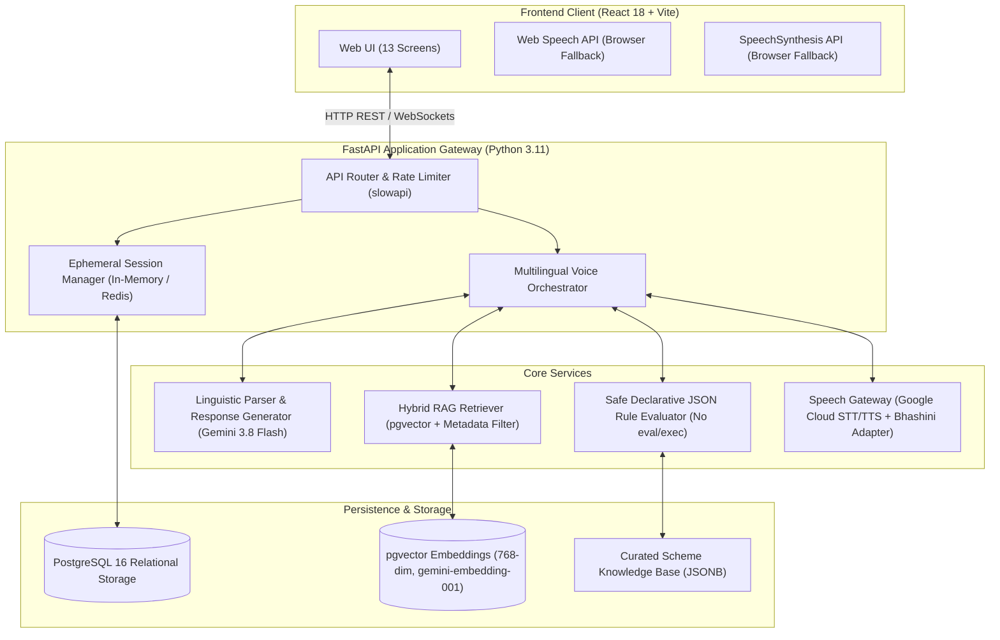
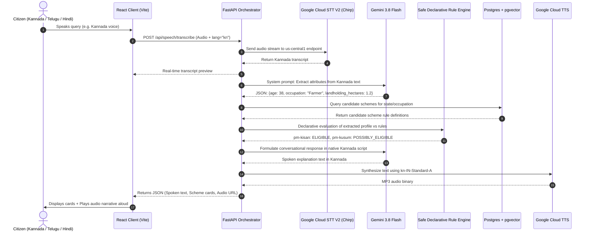

# PHASE 3 — BACKEND & SYSTEM ARCHITECTURE DESIGN (VERIFIED & AUDITED)
## Project: Yojana Saathi (योजना साथी)
**Status:** Independently Verified & Audited  
**Research Verification Date:** November 10, 2026  
**Document Version:** 2.0 (Phase 3.1 Corrections Applied)  
**Target Languages:** English (`en`), Hindi (`hi`), Kannada (`kn`), Telugu (`te`)

---

## 1. System Architecture Overview

Yojana Saathi enforces a strict **Separation of Concerns**:
- **Linguistic Understanding & Explanation:** Handled by **Google Gemini 3.8 Flash** (`gemini-3.8-flash`).
- **Eligibility Decisions:** Handled exclusively by a **Safe Declarative JSON Rule Interpreter** (pure dictionary traversal in Python). The LLM is strictly prohibited from computing eligibility or inventing rules.
- **Speech Processing:** Handled by **Google Cloud STT V2 Chirp** (with Browser Web Speech fallback) and **Google Cloud TTS** (with Browser SpeechSynthesis fallback).
- **Knowledge Retrieval:** Handled by **PostgreSQL 16 + pgvector** via hybrid metadata filtering and semantic vector search using `gemini-embedding-001` (768-dim).



---

## 2. Safe Declarative Eligibility Rule Engine (Task 8 & Review Audit)

### 2.1 The Safety Imperative: Zero Arbitrary Code Execution
`[VERIFIED FACT]` To ensure security and prevent arbitrary code execution vulnerabilities:
- **No `eval()`, `exec()`, or Python `ast.parse()` code execution is permitted.**
- The rule engine is implemented as a **Safe Declarative JSON Tree Traversal** using an explicit, whitelisted operator dispatch table.
- Rules are defined as pure declarative data in JSON/JSONB and loaded from `data/schemes.json`.

### 2.2 Whitelisted Operator Specification
The rule engine supports an explicit set of operators:

1. **Logical Combinators:**
   - `all_of`: Logical AND (all sub-conditions must evaluate to `true`).
   - `any_of`: Logical OR (at least one sub-condition must evaluate to `true`).
   - `none_of`: Logical NOT / Exclusion (all sub-conditions must evaluate to `false`; if any evaluates to `true`, the candidate is immediately disqualified).
2. **Field Comparison Operators:**
   - `equals`: Exact equality (`profile[field] == value`).
   - `not_equals`: Inequality (`profile[field] != value`).
   - `greater_than`: Numeric comparison (`profile[field] > value`).
   - `greater_than_or_equal`: Numeric comparison (`profile[field] >= value`).
   - `less_than`: Numeric comparison (`profile[field] < value`).
   - `less_than_or_equal`: Numeric comparison (`profile[field] <= value`).
   - `in`: Membership test (`profile[field] in list_of_values`).
   - `not_in`: Exclusion test (`profile[field] not in list_of_values`).

---

### 2.3 Canonical Declarative Rule Schema with Official Source Traceability
Every condition carries an explicit `citation` object linking back to official government operational manuals:

```json
{
  "scheme_id": "pm-kisan",
  "rule_version": "2026.1",
  "conditions": {
    "all_of": [
      {
        "id": "pmk_c1",
        "field": "occupation",
        "operator": "in",
        "value": ["Farmer", "Agricultural Landholder"],
        "failure_reason": {
          "en": "Applicant occupation must be farming or agricultural landholding.",
          "hi": "आवेदक का व्यवसाय किसान या कृषि भूमि धारक होना आवश्यक है।",
          "kn": "ಅರ್ಜಿದಾರರ ಉದ್ಯೋಗ ಕೃಷಿ ಅಥವಾ ರೈತರಾಗಿರಬೇಕು.",
          "te": "దరఖాస్తుదారుడి వృత్తి వ్యవసాయం లేదా రైతు అయి ఉండాలి."
        },
        "citation": {
          "source_id": "GOI-AGRI-PMKISAN-2024",
          "clause": "Section 2.1 (Eligible Categories)",
          "guidelines_url": "https://pmkisan.gov.in/Documents/OperationalGuidelines.pdf"
        }
      },
      {
        "id": "pmk_c2",
        "field": "landholding_hectares",
        "operator": "greater_than",
        "value": 0.0,
        "failure_reason": {
          "en": "Applicant must hold cultivable agricultural land.",
          "hi": "आवेदक के पास कृषि योग्य भूमि होनी चाहिए।",
          "kn": "ಅರ್ಜಿದಾರರು ಸಾಗುವಳಿ ಮಾಡಬಹುದಾದ ಕೃಷಿ ಭೂಮಿಯನ್ನು ಹೊಂದಿರಬೇಕು.",
          "te": "దరఖాస్తుదారునికి సాగు చేయదగిన వ్యవసాయ భూమి ఉండాలి."
        },
        "citation": {
          "source_id": "GOI-AGRI-PMKISAN-2024",
          "clause": "Section 2.2 (Definition of Landholder Farmer Family)",
          "guidelines_url": "https://pmkisan.gov.in/Documents/OperationalGuidelines.pdf"
        }
      }
    ],
    "none_of": [
      {
        "id": "pmk_e1",
        "field": "pays_income_tax",
        "operator": "equals",
        "value": true,
        "failure_reason": {
          "en": "Income tax payers are excluded under PM-KISAN guidelines.",
          "hi": "आयकर दाता पीएम-किसान योजना के अंतर्गत अपात्र हैं।",
          "kn": "ಆದಾಯ ತೆರಿಗೆ ಪಾವತಿದಾರರಿಗೆ ಪಿಎಂ-ಕಿಸಾನ್ ಅಡಿಯಲ್ಲಿ ಅವಕಾಶವಿಲ್ಲ.",
          "te": "ఆదాయపు పన్ను చెల్లించేవారు పీಎಂ-కిసాన్ నిబంధనల ప్రకారం అనర్హులు."
        },
        "citation": {
          "source_id": "GOI-AGRI-PMKISAN-2024",
          "clause": "Section 3 (Exclusion Categories), Item (d)",
          "guidelines_url": "https://pmkisan.gov.in/Documents/OperationalGuidelines.pdf"
        }
      }
    ]
  }
}
```

---

### 2.4 Safe Declarative Python Rule Evaluator Implementation
This implementation uses a strict functional dispatch table and executes zero dynamic code:

```python
"""
Safe Declarative Rule Evaluator for Yojana Saathi.
Zero eval(), zero exec(), zero arbitrary code execution.
"""
from enum import Enum
from typing import Any, Callable, Dict, List, Optional
from pydantic import BaseModel, Field

class EligibilityStatus(str, Enum):
    ELIGIBLE = "ELIGIBLE"
    POSSIBLY_ELIGIBLE = "POSSIBLY_ELIGIBLE"
    NOT_ELIGIBLE = "NOT_ELIGIBLE"

# Explicitly whitelisted comparison operators
OPERATORS: Dict[str, Callable[[Any, Any], bool]] = {
    "equals": lambda user_val, target: user_val == target,
    "not_equals": lambda user_val, target: user_val != target,
    "greater_than": lambda user_val, target: user_val > target,
    "greater_than_or_equal": lambda user_val, target: user_val >= target,
    "less_than": lambda user_val, target: user_val < target,
    "less_than_or_equal": lambda user_val, target: user_val <= target,
    "in": lambda user_val, target: user_val in target if hasattr(target, "__contains__") else False,
    "not_in": lambda user_val, target: user_val not in target if hasattr(target, "__contains__") else False,
}

class EvaluationResult(BaseModel):
    scheme_id: str
    status: EligibilityStatus
    matched_conditions: List[str] = Field(default_factory=list)
    unmet_reasons: List[str] = Field(default_factory=list)
    missing_fields: List[str] = Field(default_factory=list)
    citations: List[Dict[str, str]] = Field(default_factory=list)

class DeclarativeRuleEngine:
    @staticmethod
    def evaluate_condition(profile: Dict[str, Any], condition: Dict[str, Any], language: str = "en") -> tuple[Optional[bool], Optional[str], Optional[Dict[str, str]]]:
        """
        Evaluates a single condition node.
        Returns: (passed: bool | None, failure_reason: str | None, citation: dict | None)
        passed=None indicates missing data in profile.
        """
        field_name = condition["field"]
        if field_name not in profile or profile[field_name] is None:
            return None, None, None  # Field is missing

        user_value = profile[field_name]
        operator_name = condition["operator"].lower()
        target_value = condition["value"]

        operator_fn = OPERATORS.get(operator_name)
        if not operator_fn:
            raise ValueError(f"Unsupported rule operator: {operator_name}")

        try:
            is_satisfied = operator_fn(user_value, target_value)
        except (TypeError, ValueError):
            is_satisfied = False

        if is_satisfied:
            return True, None, None
        else:
            reason = condition.get("failure_reason", {}).get(language, condition.get("failure_reason", {}).get("en", "Criteria not met"))
            citation = condition.get("citation", {})
            return False, reason, citation

    @classmethod
    def evaluate_scheme(cls, profile: Dict[str, Any], rule_definition: Dict[str, Any], language: str = "en") -> EvaluationResult:
        scheme_id = rule_definition["scheme_id"]
        conditions = rule_definition.get("conditions", {})

        matched_conditions: List[str] = []
        unmet_reasons: List[str] = []
        missing_fields: List[str] = []
        citations: List[Dict[str, str]] = []

        # 1. Evaluate 'all_of' mandatory conditions
        for cond in conditions.get("all_of", []):
            passed, failure_reason, citation = cls.evaluate_condition(profile, cond, language)
            if passed is None:
                missing_fields.append(cond["field"])
            elif passed:
                matched_conditions.append(cond["id"])
            else:
                unmet_reasons.append(failure_reason)
                if citation: citations.append(citation)

        # 2. Evaluate 'none_of' statutory exclusions
        for excl in conditions.get("none_of", []):
            passed, failure_reason, citation = cls.evaluate_condition(profile, excl, language)
            if passed is True:
                # Exclusion matched -> applicant is disqualified
                unmet_reasons.append(failure_reason)
                if citation: citations.append(citation)

        # 3. Determine final status
        if unmet_reasons:
            status = EligibilityStatus.NOT_ELIGIBLE
        elif missing_fields:
            status = EligibilityStatus.POSSIBLY_ELIGIBLE
        else:
            status = EligibilityStatus.ELIGIBLE

        return EvaluationResult(
            scheme_id=scheme_id,
            status=status,
            matched_conditions=matched_conditions,
            unmet_reasons=unmet_reasons,
            missing_fields=missing_fields,
            citations=citations
        )
```

### 2.5 Verification & Testing Strategy for Rules
1. **Deterministic Test Suite:**
   - 100% code branch coverage across all comparison operators.
   - Synthetic citizen test vectors verifying standard edge cases:
     - Marginal farmer (1.0 Ha land, OBC) $\rightarrow$ PM-KISAN `ELIGIBLE`.
     - Income tax paying farmer $\rightarrow$ PM-KISAN `NOT_ELIGIBLE` citing Section 3(d).
     - Farmer with unspecified state $\rightarrow$ PM-KISAN `POSSIBLY_ELIGIBLE` prompting for state.
2. **Official Source Traceability:**
   - Every rule definition in `data/schemes.json` is linked to an exact section in official Gazette / ministry guidelines.
   - Any modification to rules requires an audit of the corresponding source PDF and updating the `rule_version` tag.

---

## 3. Proposed API Endpoint Specifications

### 3.1 `POST /api/chat`
- **Purpose:** Central conversational orchestrator. Handles user speech transcript or text, extracts demographic attributes, executes deterministic rule checking, and returns localized spoken text + scheme cards.
- **Request Body:**
```json
{
  "session_id": "sess_01JCN7K8",
  "language": "kn",
  "text": "ನಾನು 38 ವರ್ಷದ ರೈತ, 1.2 ಹೆಕ್ಟೇರ್ ಜಮೀನು ಇದೆ. ನನಗೆ ಯಾವ ಯೋಜನೆಗಳು ಸಿಗುತ್ತವೆ?",
  "is_voice_input": true
}
```
- **Response Body (`200 OK`):**
```json
{
  "message_id": "msg_01JCN7M2",
  "language": "kn",
  "spoken_response": "ನಿಮ್ಮ 1.2 ಹೆಕ್ಟೇರ್ ಕೃಷಿ ವಿವರಗಳ ಪ್ರಕಾರ, ನೀವು ಪ್ರಧಾನ ಮಂತ್ರಿ ಕಿಸಾನ್ ಸಮ್ಮಾನ್ ನಿಧಿ (ಪಿಎಂ-ಕಿಸಾನ್) ಯೋಜನೆಗೆ ಸಂಪೂರ್ಣ ಅರ್ಹರಾಗಿದ್ದೀರಿ. ವರ್ಷಕ್ಕೆ ₹6,000 ನೇರ ಸಹಾಯಧನ ಸಿಗುತ್ತದೆ.",
  "extracted_attributes": [
    { "field": "occupation", "value": "Farmer", "confidence": 0.98 },
    { "field": "age", "value": 38, "confidence": 0.99 },
    { "field": "landholding_hectares", "value": 1.2, "confidence": 0.95 }
  ],
  "missing_attributes": ["state", "annual_income"],
  "evaluations": [
    {
      "scheme_id": "pm-kisan",
      "status": "ELIGIBLE",
      "name": "ಪ್ರಧಾನಮಂತ್ರಿ ಕಿಸಾನ್ ಸಮ್ಮಾನ್ ನಿಧಿ (PM-KISAN)",
      "benefit": "ವಾರ್ಷಿಕ ₹6,000 ನೇರ ನಗದು ವರ್ಗಾವಣೆ (3 ಕಂತುಗಳಲ್ಲಿ)",
      "official_portal": "https://pmkisan.gov.in/",
      "verified_date": "2026-10-15"
    }
  ],
  "audio_url": "/api/speech/synthesize/stream?message_id=msg_01JCN7M2"
}
```

### 3.2 `POST /api/speech/transcribe`
- **Request:** `multipart/form-data` with `audio` binary (WebM/Opus) and `language` code (`en`, `hi`, `kn`, `te`).
- **Backend Action:** Calls Google Cloud STT V2 Chirp endpoint (`us-central1-speech.googleapis.com`).
- **Billing Metric:** Billed in 1-second increments (not legacy 15-second blocks).
- **Response (`200 OK`):** Returns transcription, confidence score, and detected language code.

### 3.3 `POST /api/speech/synthesize`
- **Request:** JSON payload containing `text`, `language`, and optional `rate` (0.8, 1.0, 1.2).
- **Backend Action:** Calls Google Cloud TTS with assigned voice ID:
  - Hindi: `hi-IN-Neural2-A`
  - English: `en-IN-Neural2-D`
  - Kannada: `kn-IN-Standard-A` (or generative `kn-IN-Chirp3-HD-Achernar`)
  - Telugu: `te-IN-Standard-A` (or generative `te-IN-Chirp3-HD-Achernar`)
- **Response:** Streaming `audio/mpeg` binary.

### 3.4 `GET /api/schemes` & `GET /api/schemes/{id}`
- **Purpose:** Directory retrieval of curated schemes, filtered by category, state, and language.
- **Data Source:** Read directly from PostgreSQL / `schemes.json` cache.

### 3.5 `POST /api/eligibility/evaluate`
- **Purpose:** Standalone deterministic evaluation of a complete citizen profile against target scheme rules.
- **Engine:** Direct execution of `DeclarativeRuleEngine.evaluate_scheme()`.

### 3.6 `GET /api/health`
- **Purpose:** Heartbeat and dependency check (Postgres, Gemini API, Speech API).

---

## 4. End-to-End Multilingual Voice Flow Sequence



---

## 5. Security, Privacy & Zero-Knowledge Guarantee

1. **Zero Permanent PII Storage:**
   - No citizen names, phone numbers, Aadhaar numbers, or bank accounts are recorded in the database.
   - Demographic attributes (`age`, `state`, `landholding`) are held ephemerally in session memory and cleared on session reset.
2. **Backend API Credential Isolation:**
   - Cloud keys (`GEMINI_API_KEY`, `GOOGLE_APPLICATION_CREDENTIALS`, `SUPABASE_KEY`) reside exclusively in backend environment variables. The client browser has zero access to cloud credentials.
3. **Rate Limiting:**
   - Enforced via `slowapi` token-bucket rate limiter: 30 requests/minute per client IP for conversational endpoints.
