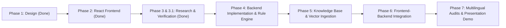

# PHASE 3 — IMPLEMENTATION ROADMAP & EXECUTION PLAN (VERIFIED & AUDITED)
## Project: Yojana Saathi (योजना साथी)
**Status:** Independently Verified & Audited  
**Research Verification Date:** November 10, 2026  
**Document Version:** 2.0 (Phase 3.1 Corrections Applied)  
**Target Languages:** English (`en`), Hindi (`hi`), Kannada (`kn`), Telugu (`te`)

---

## 1. Phased Execution Roadmap

---

## 2. Milestone Breakdown & Technical Deliverables

### Phase 4: Backend Implementation & Rule Engine (Sprint 1)
**Duration:** 1–2 Days  
**Objective:** Initialize FastAPI service, build the safe declarative JSON rule evaluator, and implement cloud speech and LLM connectors.

- **Milestone 4.1: Scaffolding & Dependency Management**
  - Initialize `backend/` directory structure.
  - Setup Python 3.11 virtual environment and lock `requirements.txt`:
    `fastapi`, `uvicorn`, `pydantic>=2.0`, `google-genai`, `google-cloud-speech`, `google-cloud-texttospeech`, `httpx`, `psycopg2-binary`, `pgvector`, `slowapi`.
  - Configure `.env.example` with `GEMINI_API_KEY`, `GOOGLE_APPLICATION_CREDENTIALS`, and `SUPABASE_DATABASE_URL`.
- **Milestone 4.2: Safe Declarative Rule Evaluator (Task 8)**
  - Implement `DeclarativeRuleEngine` in `app/services/rule_engine.py` using functional operator mapping (`equals`, `in`, `greater_than`, `less_than`, `all_of`, `any_of`, `none_of`).
  - Strict security guard: Zero `eval()`, zero `exec()`, zero dynamic Python AST execution.
  - Write unit test suite (`tests/test_rule_engine.py`) covering 100% of branch logic and edge cases.
- **Milestone 4.3: LLM Extraction Service**
  - Implement `LLMService` in `app/services/llm_service.py` using **Gemini 3.8 Flash** (`gemini-3.8-flash`).
  - Configure system prompts enforcing strict Pydantic JSON schema extraction of citizen demographic attributes.
- **Milestone 4.4: Cloud Speech Connectors**
  - Implement `SpeechService` connecting to Google Cloud STT V2 Chirp (multi-region `us-central1`) and Google Cloud TTS (`kn-IN-Standard-A`, `te-IN-Standard-A`, `hi-IN-Neural2-A`, `en-IN-Neural2-D`).

---

### Phase 5: Knowledge Base & Vector Ingestion (Sprint 2)
**Duration:** 1–2 Days  
**Objective:** Ingest verified government schemes into PostgreSQL + pgvector and verify hybrid retrieval.

- **Milestone 5.1: Curated Scheme Corpus Ingestion**
  - Finalize `data/schemes.json` containing 30 verified central and state schemes.
  - Ground every scheme with official Gazette URLs, operational manuals, and `last_verified_date`.
- **Milestone 5.2: Database Migrations & Vector Embeddings**
  - Execute PostgreSQL migrations on Supabase: create `schemes`, `scheme_rules`, and `scheme_embeddings` tables with `pgvector` extension enabled.
  - Run ingestion script using **`gemini-embedding-001`** (768-dim) to generate vector embeddings for scheme benefit clauses and summaries.
- **Milestone 5.3: Hybrid RAG Query Pipeline**
  - Implement two-stage retrieval: categorical SQL metadata filter (state, age, occupation) followed by cosine similarity ranking via pgvector.

---

### Phase 6: Frontend-Backend Integration (Sprint 3)
**Duration:** 1 Day  
**Objective:** Connect the existing React frontend with the live FastAPI backend.

- **Milestone 6.1: API Client Integration**
  - Create `src/services/apiClient.ts` in the React frontend.
  - Wire `POST /api/chat` to `AssistantChat.tsx` and `VoiceMicModal.tsx`.
- **Milestone 6.2: Audio Stream Playback & Fallback Guard**
  - Wire audio streaming from `/api/speech/synthesize` into React audio player.
  - Maintain the browser Web Speech API as an automatic fallback if network connectivity degrades.
- **Milestone 6.3: Profile Synchronization**
  - Automatically populate extracted citizen attributes into `AppContext` and the Profile Confirmation view.

---

### Phase 7: Multilingual Audits & Hackathon Demo (Sprint 4)
**Duration:** 1 Day  
**Objective:** End-to-end testing across all four languages, accessibility audits, and demo preparation.

- **Milestone 7.1: Persona-Based End-to-End Scenarios**
  - **Persona 1 (Kannada):** Ramesh (38, Small Farmer in Karnataka, 1.2 Ha) discovering PM-KISAN and PM-KUSUM.
  - **Persona 2 (Telugu):** Lakshmi (42, Rural Artisan in Telangana, ₹90,000 income) discovering Ayushman Bharat and PM SVANidhi.
  - **Persona 3 (Hindi):** Ramvati (30, Pregnant mother in UP) discovering PMMVY.
- **Milestone 7.2: Resilience & Anti-Hallucination Testing**
  - Simulate microphone permission denial $\rightarrow$ verify graceful text fallback.
  - Ask unsupported out-of-domain questions $\rightarrow$ verify anti-hallucination safe refusal.
- **Milestone 7.3: Performance Benchmarking**
  - Verify total voice turn latency $< 1.5$ seconds.

---

## 3. Required Credentials, Registrations & Approvals

| Service | Portal / Provider | Required Credentials | Status & Expected Lead Time | Fallback Plan if Delayed |
| :--- | :--- | :--- | :--- | :--- |
| **Google AI Studio** | [ai.google.dev](https://ai.google.dev/) | `GEMINI_API_KEY` | `[VERIFIED FACT]` **Instant self-serve.** 1,500 RPD free tier. | OpenAI API key (`OPENAI_API_KEY`). |
| **Google Cloud Console** | [console.cloud.google.com](https://console.cloud.google.com/) | Service Account JSON Key (STT & TTS) | `[VERIFIED FACT]` **Instant self-serve.** 60 min STT + 4M/1M chars TTS free. | Client Browser Web Speech API fallback. |
| **Supabase** | [supabase.com](https://supabase.com/) | `DATABASE_URL`, `SUPABASE_ANON_KEY` | `[VERIFIED FACT]` **Instant self-serve.** 500 MB DB free. | Local Dockerized PostgreSQL 16 + pgvector. |
| **Bhashini ULCA** | [bhashini.gov.in](https://bhashini.gov.in/) | `userID`, `ulcaApiKey`, `inferenceAPIKey` | `[UNVERIFIED ASSUMPTION / MANUAL APPROVAL]` **Uncommitted manual review.** | Google Cloud Speech services serve as primary. |
| **data.gov.in** | [data.gov.in](https://data.gov.in/) | 40-character API Key | `[VERIFIED FACT]` **Instant self-serve.** | Local curated `schemes.json` corpus. |

---

## 4. Pre-Implementation Checklist Before Phase 4 Backend Approval

- [x] All candidate government portals audited (myScheme restricted to API Setu; data.gov.in open for stats; curated canonical corpus adopted).
- [x] LLM model lifecycle verified (Gemini 3.8 Flash active; Gemini 1.5 and 2.0 Flash phase-outs addressed).
- [x] Vector embedding shutdown resolved (`text-embedding-004` shutdown on Jan 14, 2026; replaced with `gemini-embedding-001` at 768-dim).
- [x] Google Cloud STT V2 Chirp verified for `hi-IN`, `kn-IN`, `te-IN`, `en-IN` (60 min free tier, multi-region `us-central1`, 1-second billing increments).
- [x] Google Cloud TTS voice IDs verified (`kn-IN-Standard-A`, `te-IN-Standard-A`, `hi-IN-Neural2-A`, `en-IN-Neural2-D` under 4M/1M free allowances).
- [x] Bhashini SLA claims corrected (uncommitted manual approval timeline noted; relegated to secondary sovereign integration).
- [x] Cost models audited and discrepancy between ₹0.00 and ₹190.40 resolved and documented.
- [x] Rule engine verified as a safe declarative JSON dictionary interpreter (zero `eval()`, zero `exec()`).
- [x] All 4 project documentation files updated and cross-referenced.
